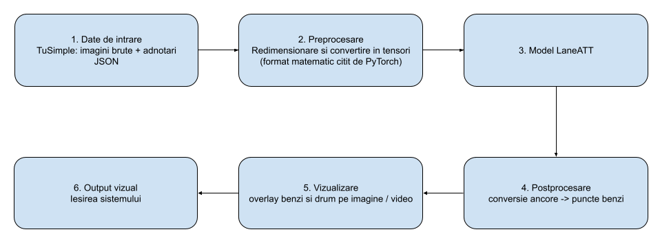

# Lane & Road Segmentation

## 1) Analiza literaturii de specialitate

| Nr. | Autor(i)&nbsp;/&nbsp;An&nbsp;&nbsp;&nbsp;&nbsp;&nbsp;&nbsp;&nbsp;&nbsp;&nbsp;&nbsp;&nbsp;&nbsp; | Titlul&nbsp;articolului&nbsp;/&nbsp;proiectului&nbsp;&nbsp;&nbsp;&nbsp;&nbsp;&nbsp;&nbsp;&nbsp;&nbsp;&nbsp;&nbsp;&nbsp;&nbsp;&nbsp;&nbsp;&nbsp;&nbsp;&nbsp;&nbsp;&nbsp; | Aplicatie&nbsp;/&nbsp;Domeniu&nbsp;&nbsp;&nbsp;&nbsp;&nbsp;&nbsp;&nbsp;&nbsp;&nbsp;&nbsp;&nbsp;&nbsp;&nbsp;&nbsp;&nbsp;&nbsp;&nbsp;&nbsp; | Tehnologii&nbsp;utilizate&nbsp;&nbsp;&nbsp;&nbsp;&nbsp;&nbsp;&nbsp;&nbsp;&nbsp;&nbsp;&nbsp;&nbsp;&nbsp;&nbsp;&nbsp;&nbsp;&nbsp;&nbsp;&nbsp;&nbsp;&nbsp;&nbsp; | Metodologie&nbsp;/&nbsp;Abordare&nbsp;&nbsp;&nbsp;&nbsp;&nbsp;&nbsp;&nbsp;&nbsp;&nbsp;&nbsp;&nbsp;&nbsp;&nbsp;&nbsp;&nbsp;&nbsp;&nbsp;&nbsp;&nbsp;&nbsp;&nbsp;&nbsp;&nbsp;&nbsp;&nbsp;&nbsp;&nbsp;&nbsp;&nbsp;&nbsp;&nbsp;&nbsp;&nbsp;&nbsp;&nbsp;&nbsp;&nbsp;&nbsp;&nbsp;&nbsp;&nbsp;&nbsp;&nbsp;&nbsp;&nbsp;&nbsp;&nbsp;&nbsp;&nbsp;&nbsp;&nbsp;&nbsp;&nbsp;&nbsp;&nbsp; | Rezultate&nbsp;&nbsp;&nbsp;&nbsp;&nbsp;&nbsp;&nbsp;&nbsp;&nbsp;&nbsp;&nbsp;&nbsp;&nbsp;&nbsp;&nbsp;&nbsp;&nbsp;&nbsp;&nbsp;&nbsp;&nbsp;&nbsp;&nbsp;&nbsp;&nbsp;&nbsp;&nbsp;&nbsp;&nbsp;&nbsp;&nbsp;&nbsp;&nbsp;&nbsp;&nbsp;&nbsp;&nbsp;&nbsp;&nbsp;&nbsp; | Limitari&nbsp;&nbsp;&nbsp;&nbsp;&nbsp;&nbsp;&nbsp;&nbsp;&nbsp;&nbsp;&nbsp;&nbsp;&nbsp;&nbsp;&nbsp;&nbsp;&nbsp;&nbsp;&nbsp;&nbsp;&nbsp;&nbsp;&nbsp;&nbsp;&nbsp;&nbsp;&nbsp;&nbsp;&nbsp;&nbsp;&nbsp;&nbsp;&nbsp;&nbsp;&nbsp;&nbsp;&nbsp;&nbsp;&nbsp;&nbsp; | Comentarii&nbsp;suplimentare&nbsp;&nbsp;&nbsp;&nbsp;&nbsp;&nbsp;&nbsp;&nbsp;&nbsp;&nbsp;&nbsp;&nbsp;&nbsp;&nbsp;&nbsp;&nbsp;&nbsp;&nbsp;&nbsp;&nbsp;&nbsp;&nbsp;&nbsp;&nbsp;&nbsp;&nbsp;&nbsp;&nbsp;&nbsp;&nbsp; |
| :---- | :---- | :---- | :---- | :---- | :---- | :---- | :---- | :---- |
| 1 | Tabelini L. (2021) | LaneATT: Keep your Eyes on the Lane: Real-time Attention-guided Lane Detection | Detectia benzilor pentru vehicule autonome (Sisteme ADAS) | Python, PyTorch, arhitecturi de retele tip ResNet (pentru extragerea trasaturilor) | Utilizeaza o abordare bazata pe ancore (anchor-based) in care propune linii predefinite peste imagine, pe care le ajusteaza folosind un „mecanism de atentie” (attention mechanism) capabil sa extraga context global din imagine (nu doar local) | Pe setul de date TuSimple (benchmark-ul standard), modelul a obtinut un F1-score de **96.71%**, ruland cu o viteza excelenta de **171 FPS** (cu un backbone ResNet-34), depasind la acel moment modelele concurente la viteza | Modelul foloseste ancore care pornesc doar de pe marginile imaginii (stanga, dreapta, jos). Acest lucru limitează flexibilitatea algoritmului in intersectii complexe sau in scenarii unde liniile nu respecta tiparele vizuale obisnuite ale autostrazilor | Acesta este modelul principal selectat pentru implementarea proiectului nostru datorita echilibrului optim intre acuratetea ridicata si timpul de executie necesar în conditii reale |
| 2 | Kunyang Zhou (2024) | Lane2Seq: Towards Unified Lane Detection via Sequence Generation | Detectia benzilor de circulatie (Format Unificat) | Arhitectura Transformer (Encoder-Decoder), similara cu cea din ChatGPT | Abordarea este complet diferita. In loc sa caute pixeli sau linii pe imagine (cum face LaneATT), acest AI trateaza imaginea ca pe un „text”. Modelul se uita la strada si genereaza (scrie) un sir de coordonate matematice, exact asa cum ChatGPT genereaza cuvinte unul dupa altul | Obtine o precizie de top (peste 96% F1-score) pe seturile de date mari (inclusiv TuSimple), dovedind ca o abordare de tip „generare de text” functioneaza excelent pentru imagini | Deoarece trebuie sa genereze coordonatele pas cu pas (secvential), algoritmul este mai lent și are un FPS mai mic, fiind greu de folosit pe o masină care ruleaza cu o viteza mare | Arata o perspectiva noua: folosirea tehnologiilor de „limbaj” pentru a rezolva probleme vizuale de condus autonom. |
| 3 | Kunyang Zhou, Yeqin Shao (2025) | DiffusionLane: Diffusion Model for Lane Detection | Detectia benzilor de circulatie | Modele de Difuzie (Diffusion Models) | Aceasta lucrare imprumuta tehnologia folosita de AI-urile care genereaza imagini (precum Midjourney sau DALL-E). Modelul deseneaza la intamplare niste linii gresite, pline de "zgomot", pe imaginea cu strada. Apoi, intr-un proces pas cu pas (numit "denoising" / curatarea zgomotului), AI-ul muta si ajusteaza aceste linii haotice pana cand ajung sa se suprapuna perfect peste benzile reale de pe asfalt | Datorita rafinarii pas cu pas, algoritmul gaseste benzile cu o precizie foarte mare, obtinand rezultate de top chiar si atunci cand liniile de pe drum sunt deteriorate sau sterse | Deoarece trebuie sa repete acel proces de "curatare a zgomotului" de mai multe ori pentru o singura imagine, modelul este mare consumator de resurse (are nevoie de placi video foarte puternice) si este lent (FPS mic) | Este un exemplu perfect care arata cum o tehnologie folosita initial pentru a genera arta/imagini din text a fost modificata ingenios pentru o aplicatie de siguranta auto |
| 4 | Daichao Zhao, Qiupu Chen, Feng He, Xin Ning, Qiankun Li (2026) | HG-Lane: High-Fidelity Generation of Lane Scenes under Adverse Weather and Lighting Conditions without Re-annotation | Generare de date auto / Detectie pe vreme rea | Stable Diffusion, CLIP (AI Generativ pentru manipulare de imagini) | Marea problema a setului de date TuSimple este ca pozele sunt facute in mare parte pe vreme buna. In loc sa mearga fizic sa filmeze pe ninsoare sau ceata si sa deseneze manual coordonatele din nou, autorii au folosit AI-ul ca pe un filtru avansat. AI-ul ia o poza cu soare din TuSimple, o transforma intr-o poza cu furtuna sau noapte, dar pastreaza coordonatele benzilor exact in acelasi loc | Antrenand sistemele de condus autonom si pe aceste poze modificate, modelele au devenit mult mai sigure si mai capabile sa gaseasca benzile in conditii meteo extreme | Oricat de buna ar fi simularea, ploaia sau ceata generate pe calculator (date sintetice) nu pot reproduce 100% zgomotul optic real pe care il pateste senzorul unei camere auto in viata de zi cu zi | Evidentiaza o problema clara a setului de date TuSimple (lipsa diversitatii meteo) și propune o solutie foarte moderna, fara a necesita munca manuala (fara re-etichetare) |
| 5 | Dongkwon Jin, Dahyun Kim, Chang-Su Kim (2023) | Recursive Video Lane Detection | Detectia benzilor din secvente video (Rezolvarea ocluziunilor) | Arhitectura Transformer, module cu memorie temporara (Key-value cache) pentru procesare video | Majoritatea AI-urilor analizeaza o singura poza izolata. Daca o alta masina din fata acopera liniile de pe asfalt, AI-ul devine "orb" in acea zona. Acest algoritm foloseste insa o abordare video: el memoreaza exact unde era banda in cadrul (secunda) anterior si transfera acea informatie in cadrul actual. Astfel, AI-ul poate "intui" pe unde continua linia chiar daca fizic ea este acoperita de un obstacol | Depaseste vizibil performantele metodelor clasice bazate pe poze statice, fiind mult mai stabil si mai sigur in conditii de trafic foarte aglomerat | Mentinerea acestei „memorii" a cadrelor trecute necesita mai multa memorie RAM pe computerul masinii si un consum mai mare de procesor comparativ cu evaluarea unei singure imagini | Demonstreaza importanta utilizarii informatiei temporale (istoricul de miscare) in sistemele de condus autonom pentru a asigura o predictie continua si stabila a benzilor in trafic aglomerat |

## 2) Proiectarea solutiei

1) **Date de intrare**: Contine imaginile brute de pe TuSimple si adnotarile in format JSON, necesare validarii rezultatelor  
2) **Preprocesare**: Se pregatesc datele pentru procesare prin redimensionarea lor si conversia in tensori pentru a putea fi intelese de PyTorch  
3) **LaneATT**: Reteaua neuronala efectiva ce preia datele preprocesate si prezice matematic pozitia benzilor, fiind impartita in 2 sub-module: Backbone(ResNet), care extrage o harta de trasaturi a imaginii, si mecanismul de atentie, care foloseste linii teoretice numite ancore ce pornesc din stanga, dreapta si din baza imaginii pentru analiza pixelilor de-a lungul acestora si a vedea daca fac parte dintr-un marcaj real  
4) **Postprocesare**: Converteste ancorele in coordonate prin filtrarea rezultatelor obtinute anterior, reteaua generand mai multe predictii pentru aceeasi banda  
5) **Vizualizare**: Se preiau coordonatele si se suprapune o interpolare a acestora direct peste imaginea originala, marcand vizual benzile obtinute, fara a deteriora textura cadrului original  
6) **Output vizual**: Imaginea obtinuta la iesire, comparand totodata rezultatul obtinut cu adnotarile JSON, calculand si False Positives, False Negatives, iar in final scorul F1 pe intregul set de date  
